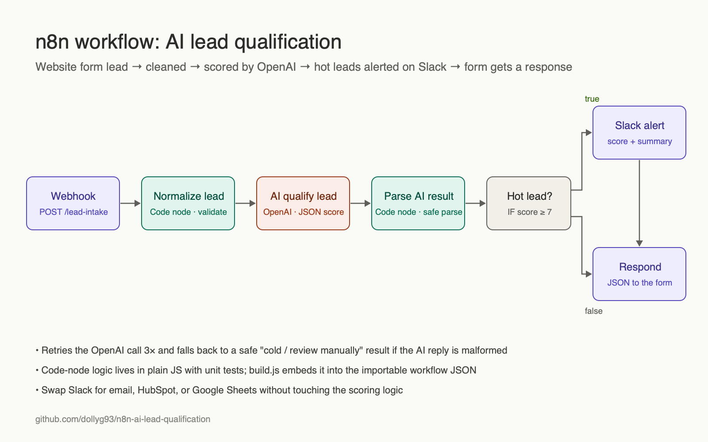

# n8n AI Lead Qualification Workflow

An importable [n8n](https://n8n.io) workflow that takes a lead from your website form, has
OpenAI score and summarize it, pings your sales channel on Slack when it's a hot lead, and
replies to the form with the result.



## What it does

| Step | Node | Purpose |
|------|------|---------|
| 1 | Webhook `POST /lead-intake` | Receives the form submission |
| 2 | Code: Normalize lead | Validates email + message, trims and lowercases fields |
| 3 | HTTP Request: AI qualify lead | Calls OpenAI (`gpt-4o-mini`, JSON mode) for score 0–10, category, summary, next step. Retries 3× |
| 4 | Code: Parse AI result | Safely parses the AI reply; malformed output falls back to `cold` / "Review manually" instead of breaking the run |
| 5 | IF: Hot lead? | `score >= 7` |
| 6 | HTTP Request: Alert sales on Slack | Posts name, email, score, summary and next step |
| 7 | Respond to Webhook | Returns `{ ok, score, category }` to the form |

## Import it

1. In n8n: **Workflows → Import from file** → `ai-lead-qualification.json`
2. Open **AI qualify lead** and select your OpenAI credential
3. Open **Alert sales on Slack** and paste your Slack incoming-webhook URL
4. Activate, then send a test lead:

```bash
curl -X POST https://<your-n8n>/webhook/lead-intake \
  -H 'Content-Type: application/json' \
  -d '{"name":"Priya","email":"priya@acme.io","budget":"$2k","message":"We copy Shopify orders into Sheets by hand every day and want it automated this month."}'
```

## How the code is organised

The Code-node logic lives in `normalizeLead.js` and `parseQualification.js` as plain JavaScript so it can be unit tested.
`build.js` embeds those functions into the workflow JSON, so the file you import runs
exactly the code the tests cover.

```bash
npm test   # regenerates the workflow JSON, then tests the functions, the wiring,
           # and the embedded Code-node scripts in a sandbox
```

## Adapting it

Swap the Slack node for Gmail, HubSpot, Pipedrive or Google Sheets, or add a second branch
that drops warm leads into a nurture sequence — the scoring and parsing steps stay the same.
